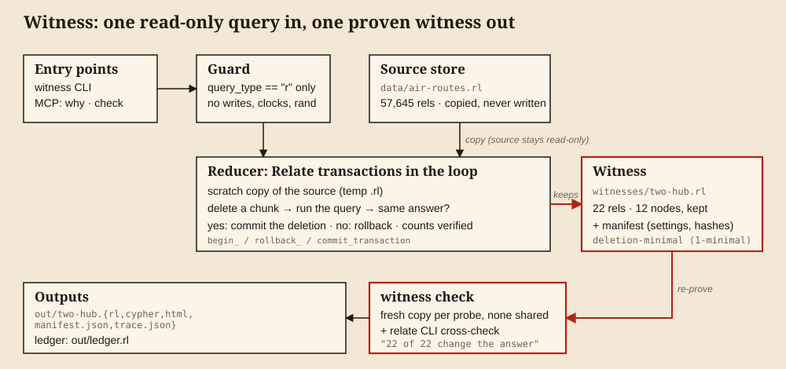

<div align="center">
  
  <h1>Witness 🔎</h1>
  <p><em>When an agent answers from a graph, Witness hands back the graph that reproduces the answer (57,645 relationships → 22) and proves each relationship in it is needed.</em></p>
  

  <br/>

  [](https://witness-wheat.vercel.app)
  [](https://witness-wheat.vercel.app/judge/)
  [](https://relate.devpost.com/)

  <br/>

  [](https://github.com/edycutjong/witness/actions/workflows/ci.yml)
  [](https://github.com/edycutjong/witness/releases/latest)
  
  
  
  [](LICENSE)

</div>

---

## 💡 The Problem & Solution

**Use case:** checking an agent's graph answer by reading 22 relationships instead of 57,645.

### The Problem

An agent answers a question from a graph of tens of thousands of relationships. A reviewer cannot read them all, so the
answer is taken on trust. "Show the path" is not enough either: a path can include relationships that change nothing.

### The Solution

**Who benefits:** the developer whose agent answers from a graph and who has to show why an answer is right before anyone
acts on it (the same loop turns a failing test's graph into a small fixture).
Witness takes a read-only query and its answer and deletes relationships, with Relate transactions as the inner loop, until
no single remaining relationship can go without changing the answer. What is left is a witness: a small `.rl` file anyone can
re-run with plain `relate`.

On the committed air-routes graph, the headline question (`queries/two-hub.cypher`: which Mexican airports have no direct flight to MEX, yet reach it in two flights through at least two different hubs, so they would still reach it if any one hub closed)
shrinks **57,645 relationships to 22** (12 nodes) in 371 trials and 1.1 s, and `witness check` confirms "22 of 22 change the
answer" on the Python API and on the Relate CLI (`witnesses/two-hub.manifest.json`).

**Against "show the path".** The answer rows bind 68 relationships (`queries/two-hub-bindings.cypher`). Deleting each of
those 68 from the full graph changes the answer for only 20 of them; the other 48 change nothing, because other routes back
them up (`evidence/neo4j-compare-2026-11-24.md`, targeted pass). The witness keeps 22, and deleting any one of them from the
witness changes the answer. Necessity is proven inside the witness, not in the full graph.

**How 371 trials remove 57,623 relationships.** The `EXPLAIN` plan shows `:ON_CONTINENT` cannot reach the answer, so trial 2
drops its 3,504 relationships at once. Phase A runs ddmin (delta debugging) over nodes: one `DETACH DELETE` takes a node with
all its relationships, and 69 of 253 trials keep the answer (3,729 nodes go; 54,141 → 50 relationships). Phase B runs ddmin over
the 50 remaining relationships (16 of 116 trials keep it; 50 → 22). 86 deletions applied, 285 rolled back
(`witnesses/two-hub.trace.json`).

**Deletion-minimal** means: no single remaining relationship (or kept isolated node) can be removed without changing the
answer. It does not mean "smallest possible". Because Relate's query semantics are not monotone, a witness proves its own
answer on its own file; it does not prove that every superset of it gives the same answer. A witness also leaves out true
facts the answer does not need: MEX has no country link in `witnesses/two-hub.rl`. It reproduces an answer, not the world.

**Absences.** The headline's `NOT EXISTS` (no direct flight to MEX) is an absence, and no subgraph can draw one. Every answer
row already required that absence in the full graph, the manifest records the full graph's answer (`baseline`), and the witness
reproduces it. `witness demo` also prints the full graph's counts per airport (the ABSENT block); `witness why` on other
queries reports the full graph's answer but not those per-clause counts.

**A second case: two queries disagree.** An agent's first try at the same question matched the first flight in either
direction (`queries/two-hub-agent.cypher`). On 6 of 232 country and busiest-airport pairs the two queries disagree
(`bench/disagree_scan.py`, `evidence/disagree-scan.json`). For India and DEL, `witness why --predicate disagree` shrinks
57,645 relationships to 5 in 139 trials, and `witness check` confirms "5 of 5 end the disagreement"
(`witnesses/direction-bug.*`, `evidence/direction-bug-run.txt`). The five show the bug: `(VNS)-[:HAS_ROUTE]->(AGR)` is a flight
into Agra, which the agent's query counted as Agra's second hub.

**What it refuses (exit 2):** anything outside a read-only, deterministic subset. Witness's own token check refuses writes,
procedures, `LOAD CSV`, clocks, randomness and store ids, then Relate's own `query_type` must be `"r"`; plus a heuristic check
for storage-order dependence. Witness never writes to the source.

### How it uses Relate

- **Mode:** single file (`.rl`). Reductions run on a file-backed scratch copy of the source in a temp dir; the committed
  source is copied byte-for-byte, never opened for writing, and its SHA-256 is checked unchanged after every run.
- **Why this mode:** the unit of evidence is a file. One `.rl` per witness can be committed, handed over and re-run by a
  reviewer with `relate` alone, with no server. A directory store is many files; `:memory:` disappears when the process ends
  and cannot be inspected.
- **What the graph models:** the air-routes network (Kelvin Lawrence): 3,504 airports, 237 countries and 7 continents (3,748 nodes), and
  57,645 relationships (`HAS_ROUTE`, `IN_COUNTRY`, `ON_CONTINENT`). The relationships that matter are the ones that carry a query's answer.
- **Where the data lives:** `data/air-routes.rl` (source), `witnesses/two-hub.rl` (the committed witness), `witness.rl` (the
  ledger of reductions), `fixtures/` (fixture-mode stores).

Relate capabilities used:

1. explicit transactions (`begin_transaction` / `rollback_transaction` / `commit_transaction`), the reducer's inner loop (`store.py`, `ledger.py`)
2. `QueryResult.query_type` to refuse non-read queries (`guard.py`)
3. `EXPLAIN` plans to drop labels and types a query cannot reach in one verified step (`reduce.py`)
4. `read_only=True` opens, so the rerun, ledger-reader and fixture-test paths cannot write (`cli.py`, `ledger.py`, `fixture.py`)
5. single-file `.rl` stores as the witness, source and ledger format (`export.py`, `ledger.py`)
6. `relate pull` for fixture mode: one pull from Neo4j, then shrink; never pushed back (`fixture.py`)
7. `relate query --mode json` on the CLI as the independent re-check of every probe (`check.py`)
8. MCP: Witness's own tools `why` and `check` (`mcp_server.py`) run beside Relate's `relate serve --mcp`; the pairing is exercised in `scripts/mcp_transcript.py` and `evidence/mcp-transcript.md`, and with a real model in `evidence/mcp-agent-session.md`

## 🏗️ Architecture & Tech Stack

<p align="center"></p>

| Layer | Choice |
|---|---|
| Engine | Relate 1.0.1 (`relate-db`, embedded, single file) |
| Reducer, checker, CLI, MCP | Python 3.11+ (developed on 3.12), `uv` |
| Source data | air-routes by Kelvin Lawrence (Apache-2.0), reshaped for Relate; see `NOTICE`, `data/SOURCE.md` |
| Landing | static `site/` on Vercel, built from the committed witness by `scripts/build_site.py` |

## 🚀 Getting Started (setup and run)

### Prerequisites

[`uv`](https://docs.astral.sh/uv/) and Python 3.11 or newer. The optional CLI cross-check needs the `relate` CLI (signed installer at relatedb.ai).

### Installation

```bash
git clone https://github.com/edycutjong/witness && cd witness
uv sync              # optional: install the locked dependencies (uv run does this on first use)
uv run witness demo
```

`demo` copies the committed source graph (`data/air-routes.rl`, never modified), asks the headline question
(`queries/two-hub.cypher`), reduces the answer to a deletion-minimal witness, re-proves it with `witness check`, and writes
`out/two-hub.{rl,cypher,manifest.json,html,trace.json}` plus a ledger row in `out/ledger.rl`. Nothing it runs changes a
committed file. The committed result of the same run is in `witnesses/two-hub.*`, `answers/two-hub.json` and `witness.rl`.

Then re-run the witness yourself with plain `relate`:

```bash
relate query --database witnesses/two-hub.rl --read-only --param country=MX --param dest=MEX < queries/two-hub.cypher
```

### Commands

| Command | What it does |
|---|---|
| `witness demo` | the whole path on the committed graph |
| `witness why -f Q.cypher [--param k=v] [--predicate keep\|differs\|disagree]` | reduce any read-only query's answer |
| `witness check W.rl` | re-prove a witness from its manifest: "N of N change the answer" (exit 0/1) |
| `witness rerun W.rl -f Q.cypher [--param k=v] [--print-cli]` | re-run the query on a witness, read-only, no CLI needed |
| `witness export <ledger-id\|out-dir\|W.rl> --to DIR` | copy a reduction's files |
| `witness review [ID] [--accept\|--dispute REASON]` | list unreviewed reductions, or record a verdict |
| `witness mcp [--allow DIR]` | stdio MCP server with tools `why` and `check`, beside Relate's own `relate serve --mcp` (needs the `mcp` extra: `uv run --extra mcp witness mcp`); see [Use it from an agent](#use-it-from-an-agent-mcp) |
| `witness fixture --from neo4j.env --pull SLICE.cypher --test Q.cypher --expect ROWS.json` | `relate pull` a slice from Neo4j once, shrink it to a deletion-minimal fixture (no single relationship can go without changing the test's answer), write a pytest file; never pushes back (`fixtures/mex-foreign.*`: 1,272 relationships pulled, 126 kept, 126 of 126 change the answer) |

Exit codes: 0 verified · 1 NOT verified · 2 refused (outside the supported read-only subset: no writes, procedures, `LOAD CSV`, clocks, randomness, store ids or
storage-order dependence, the last one heuristic) · 3 trial cap ·
4 aborted by the demo watchdog.

Variants: with `--predicate disagree` "deletion-minimal" reads "without ending the disagreement", and with `differs --loose` "without ending the mismatch".

"The same answer" is exact about types (`1`, `1.0` and `true` differ) and compares rows as a bag (row order is not part of
the answer, even under a final `ORDER BY`; only an `ORDER BY` with `SKIP`/`LIMIT` uses the order, and Witness applies that
cut itself), lists as bags unless `--strict-lists` (the headline demo uses it), floats to 12 significant digits
(`--float-digits`). Each manifest records
these settings under `comparison`. The proof is `witness check`: one fresh copy of W per probe, nothing shared with the
reduction. The node and relationship counts checked after every rollback during the reduction are a tripwire for rollback
residue, not the proof.

### Use it from an agent (MCP)

`witness mcp` is a stdio MCP server with two tools; run it beside Relate's own MCP server. A client config (use your clone's path):

```json
{"mcpServers": {
  "relate":  {"command": "relate", "args": ["serve", "--database", "/path/to/witness/data/air-routes.rl", "--read-only", "--mcp", "stdio"]},
  "witness": {"command": "uv", "args": ["run", "--directory", "/path/to/witness", "--extra", "mcp", "witness", "mcp"]}
}}
```

- `why(statement, parameters?, store?, predicate?, expected?, other_statement?, answer?)` reduces the answer and returns
  `verified`, the `check` line ("N of N change the answer"), the exhibits, the witness files and `evidence_markdown` (at most
  25 lines) to paste into the reply. Pass the rows you showed as `answer`: if they differ from the store's answer, nothing is
  attached. Stores must sit in `data/` or `witnesses/` (`--allow DIR` adds more).
- `check(witness_path, statement?, parameters?)` re-proves a witness from its `.rl` and manifest.
- Replies are bounded (at most 50 exhibits and answer rows, with the totals) so a client can read them; the manifest beside
  the witness keeps everything.

Two recorded sessions: `evidence/mcp-transcript.md` (a scripted client: an answer, a refused write, a mismatched answer) and
`evidence/mcp-agent-session.md` (a real model, claude-sonnet-5-5 in Claude Code, writing its own Cypher and attaching the
witness: 68 of 68, because its answer also reports hub counts).

### Measured against Neo4j

The same rollback-trial loop (delete one relationship, run the headline query, roll back, check counts) ran on Relate in-process
(a file-backed scratch copy) and on Neo4j 2026.10.2 in Docker over Bolt: median of 3 runs of 1,000 trials, 366.8 vs 90.2
trials/s on one machine, with identical answers per trial: 1,000 sampled relationships run 3 times (2 of them change the answer), plus all 68
answer-relevant relationships (20 change it). The
throughput includes each side's count check (two extra Bolt queries per trial on Neo4j); per-trial latency from begin to
rollback, which excludes it on both sides, is p50 2.54 vs 6.48 ms (median of the 3 runs). The gap mostly reflects an embedded engine versus a Dockerised server with a network round trip per statement; it says nothing about Neo4j's query engine. Method, caveats and raw rows:
`evidence/neo4j-compare-2026-11-24.md`, `bench/neo4j_compare.py`.

## 🧪 Testing & CI

```bash
make ci                          # ruff, mypy, pytest with the 100% coverage gate, pip-audit, gitleaks
uv run pytest --cov=witness      # 505 pass against real Relate (2 more need a local Neo4j), 100% line + branch coverage
```

Reproduce every number in this README: [DEMO.md](DEMO.md). Raw evidence and the machine/version of each run:
`evidence/` (this suite's run: `evidence/pytest-2026-11-26.txt`; the last full local CI run: `evidence/ci-local-2026-11-24.txt`). The tests use real Relate, not mocks of the graph store. The graph store, the rollback transactions and the queries are never mocked. `relate pull` is stood in for in the fixture-mode tests (it needs a running Neo4j server; the Neo4j side is exercised by `bench/neo4j_compare.py`), and a few tests substitute timers, process calls, a failing CLI or one reducer phase to force a rare branch.

GitHub Actions (`.github/workflows/ci.yml`) runs six stages: **Quality** (ruff, mypy, tests with the coverage gate; Python 3.11
and 3.12 on `main`) and **Security** (gitleaks over the full history, pip-audit) in parallel, then **Build** (wheel, sdist,
the site checked against the committed evidence), **E2E** (the built wheel: `witness demo`, the plain Relate CLI re-running the
committed witness, the site and `/judge/` with no credentials), **Performance** (a throughput floor) and a **Deploy Gate**.
CodeQL and secret scanning run on their own; releases are cut from Angular-style commit messages
(`.github/workflows/release.yml`); Dependabot proposes grouped minor and patch updates monthly and never a major.
For judges: [JUDGE.md](JUDGE.md), also served at <https://witness-wheat.vercel.app/judge/>.

## 📽️ Demo Materials

- Landing page: https://witness-wheat.vercel.app (`site/`)
- Reproduce steps: [DEMO.md](DEMO.md)

## 🧰 Tools and AI use

- **Product capabilities:** Relate 1.0.1 (embedded engine, `relate` CLI, `relate serve --mcp`).
- **Third-party tools:** `uv`, pytest, Neo4j 2026.10.2 in Docker (comparison and fixture source only), Vercel (landing hosting).
- **AI use:** built with Claude Code as the coding agent, under the author's direction. The author is responsible for the result.
- **Built during the contest period:** first commit 2026-11-15 (`git log --reverse`). No code from before the contest.
- **Reused material:** the air-routes dataset by Kelvin Lawrence (Apache-2.0, commit `efd3b1a`), modified as stated in `NOTICE`.

## 📄 License

Apache-2.0. See [LICENSE](LICENSE) and [NOTICE](NOTICE).
