<div align="center">
  
  <h1>Witness 🔎</h1>
  <p><em>Witness: why does this query return this row? A deletion-minimal graph that reproduces the answer (57,645 relationships → 22): deleting any one of its relationships changes the answer.</em></p>
  

  <br/>

  [](https://witness.edycu.dev)
  [](https://witness.edycu.dev/judge/)
  [](https://relate.devpost.com/)

  <br/>

  [](https://github.com/edycutjong/witness/actions/workflows/ci.yml)
  [](https://github.com/edycutjong/witness/releases/latest)
  
  
  
  [](LICENSE)

</div>

---

## 💡 The Problem & Solution

**Use case:** an agent answered a question from a graph of 57,645 relationships. Witness hands back the 22 that reproduce
the answer and shows that each of the 22 is needed. A reviewer reads 22 relationships: not the 57,645 in the graph, and not
the 68 that a listing of the matched paths would show.

<p align="center"><br>
<sub>Rendered frame by frame from the landing page's own drawing, answer table and script, arranged into one frame. The page replays committed evidence: the reduction from <code>witnesses/two-hub.trace.json</code> (the run itself takes 1.1 s) and, for each tag, the answer recorded after deleting that relationship in a Relate transaction (<code>evidence/pull-each-tag.json</code>).</sub></p>

**Run it:** `git clone https://github.com/edycutjong/witness && cd witness && uv run witness demo` (needs [`uv`](https://docs.astral.sh/uv/)).
Expect `22 of 22 change the answer` and exit 0; details in [Getting Started](#-getting-started-setup-and-run).

### The Problem

An agent answers a question from a graph of tens of thousands of relationships. A reviewer cannot read them all, so the
answer is taken on trust. "Show the path" is not enough either: a path can include relationships that change nothing.
And when an answer looks wrong, the report is "this query returns something odd on my graph", which nobody else can open.

### The Solution

**Who benefits:** the developer whose agent answers from a graph and who has to show what an answer rests on before anyone
acts on it; and the developer who has to hand a wrong or surprising answer to someone else as a graph small enough to read.
Witness takes a read-only query and its answer and deletes relationships, with Relate transactions as the inner loop, until
no single remaining relationship can go without changing the answer. What is left is a witness: a small `.rl` file anyone can
re-run with plain `relate` (45,056 bytes for the headline; the source graph is 11,079,680 bytes, `evidence/store-bytes.json`).

On the committed air-routes graph, the headline question (`queries/two-hub.cypher`: which Mexican airports have no direct flight to MEX, yet reach it in two flights through at least two different hubs, so they would still reach it if any one hub closed, and which countries those hubs are in; a hub is
any intermediate airport)
shrinks **57,645 relationships to 22** (12 nodes) in 371 trials and 1.1 s, and `witness check` confirms "22 of 22 change the
answer" on the Python API and on the Relate CLI (`witnesses/two-hub.manifest.json`). Of the 22, 13 are flights and 9 are
country links: 4 place the answer's airports in Mexico and 5 give the hub countries the answer lists.

It shows what the rows of an answer rest on. It does not judge the query, and it does not list what keeps other rows out:
[what a witness shows, and what it does not](#what-a-witness-shows-and-what-it-does-not).

### How it uses Relate

- **Mode:** single file (`.rl`). Reductions run on a file-backed scratch copy of the source in a temp dir: one byte copy, so
  element ids are unchanged and the copy goes away with the directory. The committed source is never opened for writing, and
  its SHA-256 is checked unchanged after every run.
- **Why this mode:** the unit of evidence is a file. One `.rl` per witness can be committed, handed over and re-run by a
  reviewer with `relate` alone, with no server. A directory store is many files; `:memory:` disappears when the process ends
  and cannot be inspected.
- **What the graph models:** the air-routes network (Kelvin Lawrence): 3,504 airports, 237 countries and 7 continents (3,748 nodes), and
  57,645 relationships: `(:Airport {iata})-[:HAS_ROUTE]->(:Airport)` for a scheduled route, `(:Airport)-[:IN_COUNTRY]->(:Country {code})`
  and `(:Airport)-[:ON_CONTINENT]->(:Continent)`. The relationships that matter are the ones that carry a query's answer.
  Witness also keeps a small graph of its own, the ledger: `(:Reduction)-[:PRODUCED]->(:Witness)` and, when a person reviews
  a reduction, `(:Review {verdict, reason})-[:ON]->(:Reduction)`. "Which answers has nobody reviewed" is one query with plain
  `relate`: `MATCH (r:Reduction) WHERE NOT EXISTS { (:Review)-[:ON]->(r) } RETURN r.id, r.statement`.
- **Where the data lives:** `data/air-routes.rl` (the source), `witnesses/*.rl` (four committed witnesses; the headline is
  `witnesses/two-hub.rl`), `witness.rl` (the ledger: one reduction recorded, no review yet), `fixtures/` (fixture-mode stores).

Relate capabilities used:

1. explicit transactions (`begin_transaction` / `rollback_transaction` / `commit_transaction`), the reducer's inner loop (`store.py`, `ledger.py`)
2. `QueryResult.query_type` to refuse non-read queries (`guard.py`)
3. `EXPLAIN` plans: labels and types that neither the query text nor its plan names are dropped in one step, which a trial then has to confirm (`reduce.py`)
4. `read_only=True` opens, so the rerun, ledger-reader and fixture-test paths cannot write (`cli.py`, `ledger.py`, `fixture.py`)
5. single-file `.rl` stores as the witness, source and ledger format (`export.py`, `ledger.py`)
6. `relate pull` for fixture mode: one pull from Neo4j, then shrink; never pushed back (`fixture.py`)
7. `relate query --mode json` on the CLI as a second surface for every probe (`check.py`): it rules out a mistake in Witness's Python path, not one in the engine; for that, the witnesses are re-proved on Neo4j ([below](#measured-against-neo4j))
8. MCP: Witness's own tools `why` and `check` (`mcp_server.py`) run beside Relate's `relate serve --mcp`; the pairing is exercised in `scripts/mcp_transcript.py` and `evidence/mcp-transcript.md`, and with a real model in `evidence/mcp-agent-session.md`

### What a witness shows, and what it does not

It shows that these relationships are enough for the query to return this
answer, and that each is needed among them. It does not show that the query asks the right question: `VERIFIED` (exit 0) is
about the evidence, and a witness of a wrong answer is verified too ([below](#beyond-the-headline)). And it is not a list of
everything the answer depends on. Deleting each of the 57,645 relationships of the full graph alone changes the answer 45
times (`bench/full_graph_sensitivity.py`, `evidence/full-graph-sensitivity.json`): 10 are supports, whose deletion drops or
alters an answer row, and all 10 are in the witness; 35 are guards, each the direct flight to MEX of a Mexican airport that
is not in the answer, whose deletion adds that airport as a row. A witness holds what reproduces the rows it has, not what
keeps other rows out (one guard, ACA's flight to MEX, is in the witness because it is also a hub leg). The other 11 witness
relationships change nothing in the full graph on their own, because other hubs back them up; inside the witness the
backups are gone, and each is needed.

**Against "show the path".** The answer rows match 68 relationships (`queries/two-hub-bindings.cypher`). The witness keeps 22
of them, and deleting any one of the 22 from the witness changes the answer. What each of the 68 does in the full graph (20
change the answer when deleted alone, 48 do not) is in [JUDGE.md](JUDGE.md#the-receipts) and
`evidence/full-graph-necessity.json`.

**Deletion-minimal** means: no single remaining relationship (or kept isolated node) can be removed without changing the
answer. It does not mean "smallest possible". Because a query with `NOT EXISTS` or aggregation is not monotone, a witness proves its own
answer on its own file; it does not prove that every superset of it gives the same answer. A witness also leaves out true
facts the answer does not need: MEX has no country link in `witnesses/two-hub.rl`. It reproduces an answer, not the world.

**What it refuses (exit 2):** anything outside a read-only, deterministic subset. Writes are refused twice: by Witness's own
token check, then by Relate, whose `query_type` for the query must be `"r"`. For determinism the token check refuses
procedures, `LOAD CSV`, clocks, randomness, store ids and `shortestPath()` (it picks one of several tied paths); a test
holds that list against all 176 function names of Relate 1.0.1 (`tests/test_guard_catalog.py`), and a second store built in
reverse order has to give the same answer. That last check is a heuristic: Witness supports a subset of Cypher, it does not
prove a query deterministic. Witness never writes to the source.

### How the reduction works

**How 371 trials remove 57,623 relationships.** Trial 1 checks that the empty graph changes the answer. Neither the query
text nor its `EXPLAIN` plan names `:ON_CONTINENT`, so trial 2 tries dropping its 3,504 relationships and the 7 `:Continent`
nodes at once, and the answer holds (3,748 → 3,741 nodes). Phase A runs ddmin (delta debugging) over nodes: one `DETACH DELETE` takes a node with
all its relationships, and 69 of 253 trials keep the answer (3,729 nodes go, 3,741 → 12; 54,141 → 50 relationships). Phase B runs ddmin over
the 50 remaining relationships (16 of 116 trials keep it; 50 → 22). 86 deletions applied, 285 rolled back
(`witnesses/two-hub.trace.json`).

**Absences.** The headline's `NOT EXISTS` (no direct flight to MEX) is an absence, and no subgraph can draw one. Every answer
row already required that absence in the full graph, the manifest records the full graph's answer (`baseline`), and the witness
reproduces it. `witness demo` also prints the full graph's counts per airport (the ABSENT block); `witness why` on other
queries reports the full graph's answer but not those per-clause counts.

### Beyond the headline

The same loop holds on to other things than a right answer. Each case below is a committed witness that `witness check`
re-proves and plain `relate` re-runs.

**An engine disagreement, observed.** Relate's v1.3.0 release notes list a fix: "`EXISTS` over two `MATCH` clauses agrees
with `COUNT` on relationship uniqueness". On the pinned 1.0.1, the two ways of writing one condition
(`queries/count-two-match.cypher`, `queries/exists-two-match.cypher`) return 59 and 0 Mexican airports on the air-routes
graph. `witness why --predicate disagree` shrinks 57,645 relationships to 2 in 49 trials, "2 of 2 end the disagreement"
(`witnesses/exists-count.*`, `evidence/exists-count-run.txt`): `(MZT)-[:HAS_ROUTE]->(LAX)` and `(MZT)-[:IN_COUNTRY]->(MX)`.
The two-relationship script then separates the releases: the two forms disagree on relate-db 1.0.1, 1.1.0 and 1.2.0 and
agree on 1.3.0 (`bench/relate_versions.py`, `evidence/relate-versions.jsonl`). The fix is Relate's; the two-relationship
repro, and the answer to "which release changed this", is what Witness adds.

**One query, two engines (`--other-engine`).** The same disagreement, without writing the query twice: `witness why -f
queries/exists-two-match.cypher --param country=MX --other-engine relate-db==1.3.0` runs the query on the pinned 1.0.1 in
process and on relate-db 1.3.0 in a worker (`uv run --with relate-db==1.3.0`), deletes the same relationships on both
sides in every trial, and keeps what makes the two releases answer differently: 57,645 relationships to the same 2, in 49
trials. The other engine can be any relate-db release (`relate-db==X.Y.Z`, or `python:/path/to/python` for an interpreter
that has one) or Neo4j over Bolt (`neo4j`; an empty database, the graph is loaded once and removed afterwards).
Deletions cross to the other engine as content keys (labels, type, properties, endpoints), never as element ids.
`witness check W.rl --other-engine relate-db==1.2.0` re-proves a witness against another release: on 1.2.0 the
predicate no longer holds, because 1.2.0 still answers like 1.0.1.

**Relate's changelog, as regression fixtures.** Every read-path fix entry in Relate's release notes from v1.0.2 to v1.3.0
(72 entries, `evidence/release-notes-fixes.json`, each with its status) was tried on air-routes against 1.0.1. Seven change
an answer on this graph; the rest are spellings 1.0.1 refuses (23), new rejections (10), or not about answers on this data.
Five of the seven fixes shrink with `--other-engine` against the release that fixed them (`queries/regress/`,
`witnesses/regress/`, `evidence/regress-runs.txt`), each verified "N of N end the disagreement":

| Fix (release) | On 1.0.1, full graph | Witness |
|---|---|---|
| a WHERE over the path of a keyword shortest selector post-filters the selected paths (v1.0.2) | 548 airports | 3 relationships: MZT→LAX, MZT→IAH, LAX→IAH |
| a parenthesized projection item is its plain form (v1.2.0) | one column, `null` | 1 node |
| a node variable repeated in a cycle checks every occurrence (v1.3.0) | 122 cycles | 3 relationships |
| a variable an `OPTIONAL MATCH` bound to null matches nothing later (v1.3.0) | 1,699 paths | 2 relationships |
| a subquery reusing a name a `DISTINCT` dropped binds fresh (v1.3.0) | 18 regions | 2 nodes |
| `percentileDisc` returns the input value exactly (v1.3.0) | `1.0`, a float | 1 node |

Each witness, rebuilt in `:memory:` on 1.0.1, 1.0.2, 1.1.0, 1.2.0 and 1.3.0, changes its answer exactly at the release the
notes name and at no other (`bench/regression_table.py`, `evidence/regression-releases.jsonl`). Two of the seven do not
shrink, and Witness says why: an `EXISTS { … NEXT … }` whose answer does not depend on the data (refused: the predicate
holds on the empty graph), and a change that moves the same rows as another fix of the same release. One case of a
scope fix, a `CALL { }` subquery (60 Mexican airports on 1.0.1, 3,504 on 1.3.0), is refused at the read-only door because
relate-db 1.0.1 reports `query_type` `'rw'` for it.

**A differential run.** 219 read queries, written by an AI agent from the air-routes schema before any engine compared
them (`queries/differential.jsonl`; none was changed to make engines agree), on relate-db 1.0.1 and 1.3.0
(`bench/differential.py`, `evidence/differential.json`): 207 agree, 9 are refused by both, two `SHORTEST` queries answer
only on 1.3.0 (1.0.1 gives no answer within 20 s), and one disagrees on the data: `percentileDisc` over airport
altitudes, shrunk to 1 node (`witnesses/differential/`). The same script compares Neo4j over Bolt and shrinks each
disagreement with `--other-engine neo4j`; that leg is not in the committed run (the local Neo4j was not available).

**Found on the current release.** One differential query gave no answer on 1.3.0 either. Narrowed down: `ANY SHORTEST`
over `->+` with an inline relationship predicate, even one every relationship satisfies, takes 85.8 ms on a 24-relationship
graph, 649.9 ms on 32, 5,389.4 ms on 36 and gives no answer within 8 s on 40; without the predicate each answers in under
1 ms. The same on 1.0.1 (`bench/any_shortest_inline.py`, `evidence/any-shortest-inline.jsonl`). On air-routes the process
passed 16 GB within 2 s (`evidence/any-shortest-air-routes.txt`). Witness cannot shrink a query that never answers; the
measurement is the repro.

**A query mistake.** A plausible agent mistake, written for this case: the headline question with the first
flight matched in either direction (`queries/two-hub-agent.cypher`). On 6 of 232 country and busiest-airport pairs the two queries disagree
(`bench/disagree_scan.py`, `evidence/disagree-scan.json`). For India and DEL, `witness why --predicate disagree` shrinks
57,645 relationships to 5 in 139 trials, and `witness check` confirms "5 of 5 end the disagreement"
(`witnesses/direction-bug.*`, `evidence/direction-bug-run.txt`). The five include the flight the agent's query read backwards,
`(VNS)-[:HAS_ROUTE]->(AGR)`, as if Agra flew to VNS, so VNS counted as an extra hub on Agra's way to DEL.

**A wrong answer, reproduced smaller (`differs`).** Give Witness the answer you expected (here, the
reference query's 12 rows for India and DEL, `evidence/wrong-answer-expected.json`) and the query that gets it wrong (the
same agent query returns 13: the 12 plus AGR). `--predicate differs` holds that wrong answer fixed while it deletes:
57,645 relationships → 92 (45 nodes) in 2,099 trials, "92 of 92 change the answer", cross-checked on the Relate CLI
(`witnesses/wrong-answer.*`, `evidence/wrong-answer-run.txt`). It is the headline's test applied to an answer you say is
wrong, and the repro is larger than the disagreement witness because it must reproduce all 13 rows, not only the one that
disagrees.

**Other query shapes, and one that does not shrink.** `bench/other_queries.py` runs `witness why` on three more questions
(`queries/examples/`, `evidence/other-queries.json`): the smallest number of flights from JOG to KEF (`allShortestPaths`
over a variable-length pattern; the answer is 3 and the witness is 3 relationships, one such route), the two longest
nonstop flights out of CGK (`ORDER BY` + `LIMIT`; 2 relationships), and the Icelandic airports that have flights but none
abroad (`EXISTS` and `NOT EXISTS`; 4 relationships). A count over the whole graph is the opposite case. "How many airports
have no direct flight to MEX" (3,388) rests on everything it counts: the run stops at the default cap of 20,000 trials after
about 18 minutes (1,102 s), exit 3, NOT verified, with 38,521 relationships left. Bound such a run with `--max-seconds`.

### Prior work, and what Witness does with it

The search is delta debugging (Zeller and Hildebrandt, "Simplifying and Isolating Failure-Inducing Input", 2002), and
1-minimality is its guarantee. The word *witness* is from data provenance: Buneman, Khanna and Tan ("Why and Where: A
Characterization of Data Provenance", 2001) call a part of a database that is enough to produce an output a witness of it.
What Witness does with the two: the thing being shrunk is a graph store, not a test input; the test is a Cypher answer, and
the witness is found by search, not derived from the query's form, so the method also covers `NOT EXISTS` and aggregation,
where an answer has no single path to point at and deleting data can add rows; each trial is a Relate transaction on the
store itself (begin, delete, re-run, roll back), about 2.5 ms each here, which is what makes the search practical; and the
result is not a report but a `.rl` file that plain `relate` opens.

## 🏗️ Architecture & Tech Stack

<p align="center"></p>

| Layer | Choice |
|---|---|
| Engine | Relate 1.0.1 (`relate-db`, embedded, single file): the pin every number here was measured on. Under relate-db 1.3.0 the committed stores open unchanged and the headline reduction gives the same 22 relationships in the same 371 trials (`evidence/relate-1.3.0-2026-11-27.txt`) |
| Reducer, checker, CLI, MCP | Python 3.11+ (developed on 3.12), `uv` |
| Source data | air-routes by Kelvin Lawrence (Apache-2.0), reshaped for Relate; see `NOTICE`, `data/SOURCE.md` |
| Landing | static `site/` on Vercel, built from the committed witness by `scripts/build_site.py` |

## 🚀 Getting Started (setup and run)

### Prerequisites

[`uv`](https://docs.astral.sh/uv/) and Python 3.11 or newer; nothing else. The `relate` CLI is optional. It re-runs the witness files
by hand, whichever release you have (checked with v1.0.1 and v1.3.0, `evidence/relate-1.3.0-2026-11-27.txt`). Witness's own CLI cross-check
compares one engine version with itself, so it runs only with the v1.0.1 CLI, whose binaries are on the
[v1.0.1 release](https://github.com/relatedb/relate/releases/tag/v1.0.1) (Relate's installer installs the latest release). With
any other version on your PATH the cross-check is skipped with a notice and the Python checks still run.

### Installation

```bash
git clone https://github.com/edycutjong/witness && cd witness
uv sync              # optional: install the locked dependencies (uv run does this on first use)
uv run witness demo
```

Witness starts the `relate` CLI once per probe, so it sets `DO_NOT_TRACK=1` for those processes (and for its own, unless
you set the variable yourself): its automated runs send Relate no usage events. Your own `relate` commands are untouched.

`demo` copies the committed source graph (`data/air-routes.rl`, never modified), asks the headline question
(`queries/two-hub.cypher`), reduces the answer to a deletion-minimal witness, re-proves it with `witness check`, and writes
`out/two-hub.{rl,cypher,manifest.json,html,trace.json}` plus a ledger row in `out/ledger.rl`. Nothing it runs changes a
committed file. The committed result of the same command is in `witnesses/two-hub.*`, `answers/two-hub.json` and `witness.rl`.

Then re-run the witness yourself with plain `relate`:

```bash
relate query --database witnesses/two-hub.rl --read-only --param country=MX --param dest=MEX < queries/two-hub.cypher
```

### Commands

| Command | What it does |
|---|---|
| `witness demo` | the whole path on the committed graph |
| `witness why -f Q.cypher [--store G.rl] [--param k=v] [--predicate keep\|differs\|disagree]` | reduce any read-only query's answer, on the committed graph or on your own `.rl` (`--store`: it is byte-copied, never written). Stops at 20,000 trials by default (`--max-trials`, `--max-seconds`; exit 3) |
| `witness why -f Q.cypher --other-engine relate-db==1.3.0\|python:PATH\|neo4j` | shrink what makes two engines answer the same query differently |
| `witness check W.rl [--other-engine E]` | re-prove a witness from its manifest: "N of N change the answer" (exit 0/1); `--other-engine` re-checks an engine witness against another release |
| `witness rerun W.rl -f Q.cypher [--param k=v] [--print-cli]` | re-run the query on a witness, read-only, no CLI needed |
| `witness export <ledger-id\|out-dir\|W.rl> --to DIR` | copy a reduction's files |
| `witness review [ID] [--accept\|--dispute REASON]` | list unreviewed reductions, or record a verdict |
| `witness mcp [--allow DIR]` | stdio MCP server with tools `why` and `check`, beside Relate's own `relate serve --mcp` (needs the `mcp` extra: `uv run --extra mcp witness mcp`); see [Use it from an agent](#use-it-from-an-agent-mcp) |
| `witness fixture --from neo4j.env --pull SLICE.cypher --test Q.cypher --expect ROWS.json` | `relate pull` a slice from Neo4j once, shrink it to a deletion-minimal fixture (no single relationship can go without changing the test's answer), write a pytest file; never pushes back (`fixtures/mex-foreign.*`: 1,272 relationships pulled, 126 kept, 126 of 126 change the answer) |

Exit codes: 0 verified (the witness is deletion-minimal for its predicate; this is not a verdict on the query) · 1 NOT verified · 2 refused (outside the supported read-only subset: no writes, procedures, `LOAD CSV`, clocks, randomness, store ids or
storage-order dependence, the last one heuristic) · 3 trial cap ·
4 aborted by the demo watchdog.

The three predicates. `keep`: the query's answer stays the same. `disagree` (with `--other Q2.cypher`): the two queries'
answers differ, in any way; the reduction keeps a disagreement, not necessarily the rows that differed on the full graph
(the committed India witness keeps AGR with an empty hub list). `differs` (with `--expected ROWS`): `keep` applied to an
answer you say is wrong; the run is refused if the query already returns the expected rows, and the wrong answer is then
held fixed. `differs --loose` only asks for a non-empty answer other than the expected rows, so it can slide to a different
answer: on the committed case it ends on 5 relationships whose answer is IXE, not the extra row AGR
(`evidence/differs-loose-run.txt`). With `disagree`, "deletion-minimal" reads "without ending the disagreement"; with
`differs --loose`, "without ending the mismatch".

"The same answer" is exact about types (`1`, `1.0` and `true` differ) and compares rows as a bag (row order is not part of
the answer, even under a final `ORDER BY`; only an `ORDER BY` with `SKIP`/`LIMIT` uses the order, and Witness applies that
cut itself), lists as bags unless `--strict-lists` (the headline demo uses it), floats to 12 significant digits
(`--float-digits`). A tie that straddles a `SKIP`/`LIMIT` cut is refused on the full graph (exit 2) and makes a trial or a
probe inconclusive, never proof. The manifest keeps the statement as written; for a query with such a cut the CLI re-runs
it as written for sufficiency only, and the check line says the per-relationship CLI probes were skipped. Each manifest records
these settings under `comparison`. The proof is `witness check`: one fresh copy of W per probe, nothing shared with the
reduction. The node and relationship counts checked after every rollback during the reduction are a tripwire for rollback
residue, not the proof.

### Use it from an agent (MCP)

`witness mcp` is a stdio MCP server with two tools; run it beside Relate's own MCP server. A client config (use your clone's path):

```json
{"mcpServers": {
  "relate":  {"command": "relate", "args": ["serve", "--database", "/path/to/witness/data/air-routes.rl", "--read-only", "--mcp", "stdio"]},
  "witness": {"command": "uv", "args": ["run", "--directory", "/path/to/witness", "--extra", "mcp", "witness", "mcp"]}
}}
```

- `why(statement, parameters?, store?, predicate?, expected?, other_statement?, answer?)` reduces the answer and returns
  `verified`, the `check` line ("N of N change the answer"), the exhibits, the witness files and `evidence_markdown` (at most
  25 lines) to paste into the reply. `parameters` is an object; `store` defaults to `data/air-routes.rl`; `predicate` is
  `keep` (default), `differs` (with `expected`: the expected rows) or `disagree` (with `other_statement`: the second query).
  Pass the rows you showed as `answer` (objects keyed by column): if they differ from the store's answer, nothing is attached.
  Stores must sit in `data/` or `witnesses/` by default; `--allow DIR` (repeatable) replaces that list, so pass
  `--allow data --allow witnesses` too if you still want them (`--allow` paths are relative to where `witness mcp` starts).
- `check(witness_path, statement?, parameters?)` re-proves a witness from its `.rl` and manifest, under the comparison
  settings the manifest records (so the committed `--strict-lists` witnesses are re-proved strictly). With `statement`, the
  agent's own query is compared as `keep` against the manifest's baseline answer.
- `why` compares answers with the CLI's defaults: rows and lists as bags, floats to 12 significant digits, `differs` in its
  strict form. `--strict-lists` and `--loose` are CLI-only. Both tools cross-check on the Relate CLI unless `witness mcp`
  starts with `--no-cli`; that is a server flag, not a tool argument. When `relate` is missing or is not v1.0.1, the check
  runs on the Python surface alone and the reply says so (`check.cli`, `check.cli_used: false`).
- Replies are bounded so a client can read them: at most 50 exhibits, 50 failing probes and 50 answer rows (whole rows,
  20,000 characters at most, `rows_truncated` when some are left out), each with its total. `probes_total` says how many
  necessity probes ran; a probe whose trial gave no verdict is listed under `inconclusive_probes`, never as
  `not_necessary`. The manifest beside the witness keeps everything.

Abridged call and reply (`…` marks elided fields; `statement` carries the query text; full replies in
`evidence/mcp-transcript.md`):

```text
why {"statement": "<queries/two-hub.cypher>", "parameters": {"country": "MX", "dest": "MEX"},
     "answer": [{"airport": "PBC", "hub_countries": ["MX", "US"]}, …]}
→ {"verified": true, "witness": {"relationships": 22, "nodes": 12, …},
   "check": {"check_text": "22 of 22 change the answer (…)", "not_necessary": [], …},
   "exhibits": [{"n": 1, "start": "ACA", "type": "HAS_ROUTE", "end": "MEX"}, …], "exhibits_total": 22,
   "files": {"rl": "out/mcp-…/witness.rl", …},
   "evidence_markdown": "**Answer** (4 rows): …\n**Evidence:** 22 relationships (of 57,645) reproduce it; 22 of 22 change the answer — verified deletion-minimal. …"}
```

Two recorded sessions: `evidence/mcp-transcript.md` (a scripted client: an answer, a refused write, a mismatched answer) and
`evidence/mcp-agent-session.md` (a real model, claude-sonnet-5-5 in Claude Code, writing its own Cypher and attaching the
witness for a different answer from the headline's: its rows also report hub counts, so all 68 relationships the answer rows
bind are needed, 68 of 68).

### Measured against Neo4j

The same rollback-trial loop (delete one relationship, run the headline query, roll back, check counts) ran on Relate in-process
(a file-backed scratch copy) and on Neo4j 2026.10.2 in Docker over Bolt: median of 3 runs of 1,000 trials, 366.8 vs 90.2
trials/s on one machine, with identical answers per trial: 1,000 sampled relationships run 3 times (2 of them change the answer), plus all 68
answer-relevant relationships (20 change it). The
throughput includes each side's count check (two extra Bolt queries per trial on Neo4j); per-trial latency from begin to
rollback, which excludes it on both sides, is p50 2.54 vs 6.48 ms (median of the 3 runs). The gap mostly reflects an embedded engine versus a Dockerised server with a network round trip per statement; it says nothing about Neo4j's query engine. Method, caveats and raw rows:
`evidence/neo4j-compare-2026-11-24.md`, `bench/neo4j_compare.py`.

What the comparison does not measure is the hand-over. On a server the reduced graph is a dump or a script that needs a
running server before anyone can check it again; here it is one 45,056-byte `.rl` and the `relate` CLI.

**Re-proved on a second engine.** `witness check` runs on two surfaces of Relate, which rules out a mistake in Witness,
not one in the engine. `bench/neo4j_recheck.py` loads the rebuild script of each air-routes witness whose claim does not
depend on the engine into an empty Neo4j 2026.10.2 and repeats the proof there, every relationship deleted alone in a
rolled-back transaction: 22 of 22, 5 of 5 and 92 of 92, each verdict the same as Relate's (`evidence/neo4j-recheck.json`).

## 🧪 Testing & CI

```bash
make ci                          # ruff, mypy, pytest with the 100% coverage gate, pip-audit, gitleaks
uv run pytest --cov=witness      # 553 pass against real Relate (2 more need a local Neo4j), 100% line + branch coverage
```

Reproduce every number in this README: [DEMO.md](DEMO.md). Raw evidence and the machine/version of each run:
`evidence/` (this suite's run: `evidence/pytest-2026-11-28.txt`; CI runs the same suite on every push). The tests use real Relate, not mocks of the graph store. The graph store, the rollback transactions and the queries are never mocked. `relate pull` is stood in for in the fixture-mode tests (it needs a running Neo4j server; the Neo4j side is exercised by `bench/neo4j_compare.py`), and a few tests substitute timers, process calls, a failing CLI, a database wrapper that injects engine faults, or one reducer phase to reach a rare branch.

GitHub Actions (`.github/workflows/ci.yml`) runs six stages: **Quality** (ruff, mypy, tests with the coverage gate; Python 3.11
and 3.12 on `main`) and **Security** (gitleaks over the full history, pip-audit) in parallel, then **Build** (wheel, sdist,
the site checked against the committed evidence), **E2E** (the built wheel: `witness demo`, the plain Relate CLI re-running the
committed witness, the site and `/judge/` with no credentials), **Performance** (a throughput floor) and a **Deploy Gate**.
The demo test also requires a fresh reduction to write the committed rebuild script byte for byte, so every CI run
re-derives the headline witness on Linux under Python 3.11 and 3.12 (the committed run is macOS arm64). CodeQL and secret
scanning run on their own.
For judges: [JUDGE.md](JUDGE.md), also served at <https://witness.edycu.dev/judge/>.

## 📽️ Demo Materials

- Demo video (1:55): https://youtu.be/GYbci7TseJw
- Landing page: https://witness.edycu.dev (`site/`)
- Reproduce steps: [DEMO.md](DEMO.md)

## 🧰 Tools and AI use

- **Product capabilities:** Relate 1.0.1 (embedded engine, `relate` CLI, `relate serve --mcp`).
- **Third-party tools:** `uv`, pytest, Neo4j 2026.10.2 in Docker (comparison and fixture source only), Vercel (landing hosting). Relate 1.0.2, 1.1.0, 1.2.0 and 1.3.0 (through `uv`) as other engines and for the release tables.
- **AI use:** built with Claude Code as the coding agent, under the author's direction. The author is responsible for the result.
  The 219 queries of the differential run were written by an AI agent (Claude) from the graph's schema, before any comparison.
  The demo video's voiceover is an AI voice (ElevenLabs) reading a script drafted by Claude Code under the author's direction; its music and sound are synthesized in code.
- **Built during the contest period:** first commit 2026-11-15 (`git log --reverse`). No code from before the contest.
- **Reused material:** the air-routes dataset by Kelvin Lawrence (Apache-2.0, commit `efd3b1a`), modified as stated in `NOTICE`.

## 📄 License

Apache-2.0. See [LICENSE](LICENSE) and [NOTICE](NOTICE).
