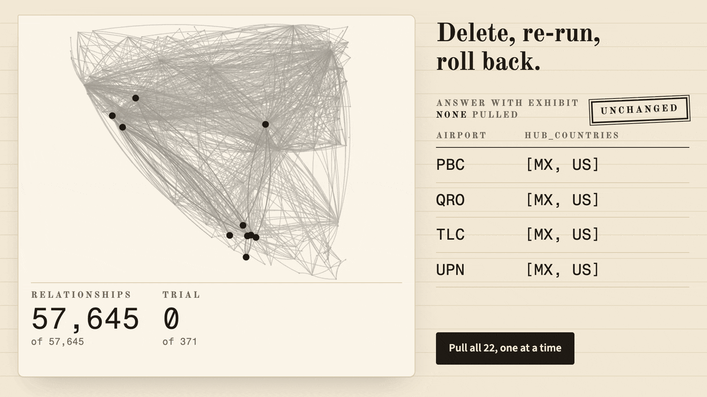

<div align="center">
  
  <h1>Witness 🔎</h1>
  <p><em>Witness: why does this query return this row? A deletion-minimal graph that reproduces the answer (57,645 relationships → 22): deleting any one of its relationships changes the answer.</em></p>
  

  <br/>

  [](https://witness.edycu.dev/judge/)
  [](https://youtu.be/4jHk1ALajRs)
  [](https://witness.edycu.dev)
  [](https://witness.edycu.dev/deck/)
  [](https://dev.to/edycutjong/57645-relationships-to-22-shrinking-a-graph-answer-with-rollback-3jdb)
  [](https://x.com/edycutjong/status/2126468870508790243)
  [](https://devpost.com/software/witness-why-does-this-query-return-this-row)

  <br/>

  [](https://github.com/edycutjong/witness/actions/workflows/ci.yml)
  
  
  
  [](LICENSE)
  [](https://github.com/edycutjong/witness/releases/latest)

</div>

---

## 💡 The Problem & Solution

### Use case

*For the developer whose agent answers from a graph and has to show what an answer rests on before anyone acts on it.*

An agent answers a question from a graph of 57,645 relationships. Witness hands back the relationships that reproduce
the answer and shows that each one is needed in it. The headline question here asks which Mexican airports would still
reach MEX if any one hub closed, and 22 relationships reproduce its answer: that is what a reviewer reads, not the 57,645
in the graph and not the 68 that a listing of the matched paths would show.

The size depends on what the answer reports. A real model asked the same question also reported how many hubs each
airport has, and for that answer all 68 matched relationships are needed, 68 of 68 (`evidence/mcp-agent-session.md`).

<p align="center"><br>
<sub>Rendered frame by frame from the landing page's own drawing, answer table and script, arranged into one frame. On the page the reduction is a replay of <code>witnesses/two-hub.trace.json</code> (the run itself takes 1.1 s), and each pull is live: Relate 1.0.1, compiled to WebAssembly, re-runs the query in your tab without that relationship, and the page compares the answer with the one recorded in a Relate transaction (<code>evidence/pull-each-tag.json</code>). This clip shows the recorded answers.</sub></p>

**No install:** open <https://witness.edycu.dev> and pull tag 15, (TIJ)→(MEX). Relate re-runs the query in your tab without
it, and PBC, QRO and UPN leave the answer.

**Run it:** `git clone https://github.com/edycutjong/witness && cd witness && uv run witness demo` (needs [`uv`](https://docs.astral.sh/uv/)).
Expect `22 of 22 change the answer` and exit 0, then open `out/two-hub.html` to see the 22 drawn; details in
[Getting Started](#-getting-started-setup-and-run).

### The Problem

An agent answers a question from a graph of tens of thousands of relationships. A reviewer cannot read them all, so the
answer is taken on trust. "Show the path" is not enough either: a path can include relationships that change nothing.
And when an answer looks wrong, the report is "this query returns something odd on my graph", which nobody else can open.
The question used throughout is of this kind: which Mexican airports would still reach MEX if any one hub closed. Whoever
reroutes on that answer, or decides not to, is acting on 22 relationships.

### The Solution

**Who benefits:** the developer whose agent answers from a graph and who has to show what an answer rests on before anyone
acts on it; and the developer who has to hand a wrong or surprising answer to someone else as a graph small enough to read
(for the people who maintain an engine, or who move a query from one Relate release to the next, that is a repro).
Witness takes a read-only query and its answer and deletes relationships, with Relate transactions as the inner loop, until
no single remaining relationship can go without changing the answer. What is left is a witness: a small `.rl` file anyone can
re-run with plain `relate` (45,056 bytes for the headline; the source graph is 11,079,680 bytes, `evidence/store-bytes.json`).

The headline question (`queries/two-hub.cypher`) is asked of the committed air-routes graph: which Mexican airports have no
direct flight to MEX, yet reach it in two flights through at least two different hubs (any intermediate airport), so they
would still reach it if any one hub closed, and which countries are those hubs in? The answer is four airports: PBC, QRO,
TLC and UPN. Witness shrinks **57,645 relationships to 22** (12 nodes) in 371 trials and 1.1 s, and `witness check`
confirms "22 of 22 change the answer" on the Python API and on the Relate CLI (`witnesses/two-hub.manifest.json`). Of the
22, 13 are flights and 9 are country links: 4 place the answer's airports in Mexico and 5 give the hub countries the answer
lists.

**Why each row is there.** Every answer row rests on seven of the 22: its two flights to a hub, each hub's flight to MEX,
its own country link, and its two hubs' country links. Each relationship was deleted alone and the query re-run
(`evidence/pull-each-tag.json`):

| Row | The row leaves the answer if one of these is deleted | The row loses a hub country if one of these is deleted |
|---|---|---|
| PBC | PBC→DFW, PBC→TIJ, DFW→MEX, TIJ→MEX, PBC in MX | DFW in US, TIJ in MX |
| QRO | QRO→DFW, QRO→TIJ, DFW→MEX, TIJ→MEX, QRO in MX | DFW in US, TIJ in MX |
| TLC | TLC→ACA, TLC→LAS, ACA→MEX, LAS→MEX, TLC in MX | ACA in MX, LAS in US |
| UPN | UPN→LAX, UPN→TIJ, LAX→MEX, TIJ→MEX, UPN in MX | LAX in US, TIJ in MX |

Four rows of seven is 28 uses, 6 of them a relationship used again: TIJ→MEX and TIJ in MX serve three rows each (PBC,
QRO, UPN), DFW→MEX and DFW in US two each (PBC, QRO). So the witness holds 28 − 6 = 22 relationships.

**What it found in Relate itself** (each in full [below](#beyond-the-headline)):

| Finding | Seen on | Shrunk to |
|---|---|---|
| An engine disagreement | Relate 1.0.1 to 1.2.0: one condition written with `COUNT` returns 59 airports, written with `EXISTS` none; fixed in 1.3.0 | 2 relationships, and which release answers what |
| Relate's release notes, as regression fixtures | 72 read-path fix entries (v1.0.2 to v1.3.0) tried on air-routes; 7 change an answer here | 6 witnesses of at most 3 relationships, each changing its answer at the release the notes name |
| A slowdown still present on Relate 1.4.0 | `ANY SHORTEST` with an inline relationship predicate: 5,000.2 ms on 36 relationships, no answer within 8 s on 40 (one run per size) | a measurement; a query that never answers cannot be shrunk |

A witness shows what the rows of an answer rest on. It does not judge the query, and it does not list what keeps other rows out:
[what a witness shows, and what it does not](#what-a-witness-shows-and-what-it-does-not).

### How it uses Relate

- **Mode:** single file (`.rl`). Reductions run on a file-backed scratch copy of the source in a temp dir: one byte copy, so
  element ids are unchanged and the copy goes away with the directory. The committed source is never opened for writing, and
  its SHA-256 is checked unchanged after every run.
- **Why this mode:** the unit of evidence is a file. One `.rl` per witness can be committed, handed over and re-run by a
  reviewer with `relate` alone, with no server. A directory store is many files; `:memory:` disappears when the process ends
  and cannot be inspected.
- **What the graph models:** the air-routes network (Kelvin Lawrence): 3,504 airports, 237 countries and 7 continents (3,748 nodes), and
  57,645 relationships: `(:Airport {iata})-[:HAS_ROUTE]->(:Airport)` for a scheduled route, `(:Airport)-[:IN_COUNTRY]->(:Country {code})`
  and `(:Airport)-[:ON_CONTINENT]->(:Continent)`. The relationships that matter are the ones that carry a query's answer.
  Witness also keeps a small graph of its own, the ledger: `(:Reduction)-[:PRODUCED]->(:Witness)` and, when a person reviews
  a reduction, `(:Review {verdict, reason})-[:ON]->(:Reduction)`. "Which answers has nobody reviewed" is one query with plain
  `relate`: `MATCH (r:Reduction) WHERE NOT EXISTS { (:Review)-[:ON]->(r) } RETURN r.id, r.statement`.

### Where the data lives

The persistent stores are committed, single-file `.rl`: `data/air-routes.rl` (the source), `witnesses/` (twelve committed
witnesses: four in `witnesses/*.rl`, the headline being `witnesses/two-hub.rl`, six regression witnesses in
`witnesses/regress/` and two in `witnesses/differential/`; each is listed with its size in
[JUDGE.md](JUDGE.md#how-it-uses-relate)), `witness.rl` (the ledger: one reduction recorded, no review yet), `fixtures/`
(fixture-mode stores).

Relate capabilities used:

1. explicit transactions (`begin_transaction` / `rollback_transaction` / `commit_transaction`), the reducer's inner loop (`store.py`, `ledger.py`)
2. `QueryResult.query_type` to refuse non-read queries (`guard.py`)
3. `EXPLAIN` plans: labels and types that neither the query text nor its plan names are dropped in one step, which a trial then has to confirm (`reduce.py`)
4. `read_only=True` opens, so the rerun, ledger-reader and fixture-test paths cannot write (`cli.py`, `ledger.py`, `fixture.py`)
5. single-file `.rl` stores as the witness, source and ledger format (`export.py`, `ledger.py`)
6. `relate pull` for fixture mode: one pull from Neo4j, then shrink; never pushed back (`fixture.py`)
7. `relate query --mode json` on the CLI as a second surface for every probe (`check.py`): it rules out a mistake in Witness's Python path, not one in the engine; for that, the witnesses are re-proved on Neo4j ([below](#measured-against-neo4j))
8. MCP: Witness's own tools `why` and `check` (`mcp_server.py`) run beside Relate's `relate serve --mcp`; the pairing is exercised in `scripts/mcp_transcript.py` and `evidence/mcp-transcript.md`, and with a real model in `evidence/mcp-agent-session.md`
9. the WebAssembly build, `@relate/relate-wasm` 1.0.1 (and 1.3.0 for the engine case), self-hosted on the landing: each pull of a tag, the reader's own read queries and both engine releases run in the reader's browser tab, checked against the recorded run (`scripts/site/live.js`, served as `site/relate/live.js`; `evidence/browser-live.json` from headless Chrome, `evidence/wasm-parity.json` under Node; DEMO.md section 15)
10. other relate-db releases beside the pinned one: `--other-engine relate-db==X.Y.Z` runs the same query on that release in a worker (`uv run --with relate-db==X.Y.Z`), which the engine case, the six regression witnesses and the release tables rest on (`engines.py`, `engine_worker.py`; 1.0.2 to 1.4.0 were used)

### What a witness shows, and what it does not

It shows that these relationships are enough for the query to return this
answer, and that each is needed among them. It does not show that the query asks the right question: `VERIFIED` (exit 0) is
about the evidence, and a witness of a wrong answer is verified too ([below](#beyond-the-headline)). And it is not a list of
everything the answer depends on. Whether a relationship is needed depends on the graph it is deleted from:

| Deleted one at a time from | Change the answer |
|---|---|
| the witness, 22 relationships | 22 of 22 |
| the full graph, the 68 the answer rows match | 20 of 68 |
| the full graph, all 57,645 | 45 of 57,645 |

Of the 45 (`bench/full_graph_sensitivity.py`, `evidence/full-graph-sensitivity.json`), 10 are supports, whose deletion drops or
alters an answer row, and all 10 are in the witness; 35 are guards, each the direct flight to MEX of a Mexican airport that
is not in the answer, whose deletion adds that airport as a row. A witness holds what reproduces the rows it has, not what
keeps other rows out (one guard, ACA's flight to MEX, is in the witness because it is also a hub leg). The other 11 witness
relationships change nothing in the full graph on their own, because other hubs back them up; inside the witness the
backups are gone, and each is needed.

**Against "show the path".** The answer rows match 68 relationships (`queries/two-hub-bindings.cypher`). The witness keeps 22
of them, and deleting any one of the 22 from the witness changes the answer. What each of the 68 does in the full graph (20
change the answer when deleted alone, 48 do not) is in [JUDGE.md](JUDGE.md#the-receipts) and
`evidence/full-graph-necessity.json`.

**Deletion-minimal** means: no single remaining relationship (or kept isolated node) can be removed without changing the
answer. It does not mean "smallest possible". A witness is also one of possibly several: another order of deletions
(`--seed`) can end on a different witness that is just as minimal (seeds 0 to 5 end on six different witnesses here, each of 22
relationships and each "22 of 22": `bench/seeds.py`, `evidence/seeds.json`). Because a query with `NOT EXISTS` or aggregation is not monotone, a witness proves its own
answer on its own file; it does not prove that every superset of it gives the same answer. A witness also leaves out true
facts the answer does not need: MEX has no country link in `witnesses/two-hub.rl`. It reproduces an answer, not the world.

**What it refuses (exit 2):** anything outside a read-only, deterministic subset. Writes are refused twice: by Witness's own
token check, then by Relate, whose `query_type` for the query must be `"r"`. For determinism the token check refuses
procedures, `LOAD CSV`, clocks, randomness, store ids, and `shortestPath()`, `SHORTEST k` and `ANY SHORTEST` (each picks
among tied paths; `ALL SHORTEST` is allowed); a test
holds that list against all 176 function names of Relate 1.0.1 (`tests/test_guard_catalog.py`), and a second store built in
reverse order has to give the same answer. That last check is a heuristic: Witness supports a subset of Cypher, it does not
prove a query deterministic. Witness never writes to the source. Two more refusals come from how Witness reads the
engine and names what it deletes. A `CALL { }` subquery is refused even when it only reads, because relate-db reports
`query_type` `"rw"` for it (1.0.1, 1.3.0 and 1.4.0). And a graph holding two nodes, or two relationships, that are alike in
every label, type, property and end node is refused: a deletion is named by those, and could not tell the two apart
(the reported `query_type` on each release: `bench/query_type_call.py`, `evidence/query-type-call.jsonl`).

### How the reduction works

**How 371 trials remove 57,623 relationships.** Trial 1 checks that the empty graph changes the answer. Neither the query
text nor its `EXPLAIN` plan names `:ON_CONTINENT`, so trial 2 tries dropping its 3,504 relationships and the 7 `:Continent`
nodes at once, and the answer holds (3,748 → 3,741 nodes). Phase A runs ddmin (delta debugging) over nodes: one `DETACH DELETE` takes a node with
all its relationships, and 69 of 253 trials keep the answer (3,729 nodes go, 3,741 → 12; 54,141 → 50 relationships). Phase B runs ddmin over
the 50 remaining relationships (16 of 116 trials keep it; 50 → 22). 86 deletions applied, 285 rolled back
(`witnesses/two-hub.trace.json`).

**Absences.** The headline's `NOT EXISTS` (no direct flight to MEX) is an absence, and no subgraph can draw one. Every answer
row already required that absence in the full graph, the manifest records the full graph's answer (`baseline`), and the witness
reproduces it. `witness demo` also prints the full graph's counts per airport (the ABSENT block); `witness why` on other
queries reports the full graph's answer but not those per-clause counts.

### Beyond the headline

The same loop holds on to other things than a right answer. Each witness below is committed, `witness check` re-proves
it and plain `relate` re-runs its query. Three things below are not witnesses, and say so: a query that never answers, two
timeouts, and a difference that holds on an empty graph. An engine witness shows its difference between the two engines
named; on a later release plain `relate` gives the fixed answer, which is what the release table records.

**An engine disagreement, observed.** Relate's v1.3.0 release notes list a fix: "`EXISTS` over two `MATCH` clauses agrees
with `COUNT` on relationship uniqueness". On the pinned 1.0.1, the two ways of writing one condition
(`queries/count-two-match.cypher`, `queries/exists-two-match.cypher`) return 59 Mexican airports and none on the
air-routes graph. `witness why --predicate disagree` shrinks 57,645 relationships to 2 in 49 trials, "2 of 2 end the disagreement"
(`witnesses/exists-count.*`, `evidence/exists-count-run.txt`): `(MZT)-[:HAS_ROUTE]->(LAX)` and `(MZT)-[:IN_COUNTRY]->(MX)`.
The two-relationship script then separates the releases: the two forms disagree on relate-db 1.0.1, 1.0.2, 1.1.0
and 1.2.0 and agree on 1.3.0 and 1.4.0 (`bench/relate_versions.py`, `evidence/relate-versions.jsonl`). The fix is Relate's; the two-relationship
repro, and the answer to "which release changed this", is what Witness adds.

**One query, two engines (`--other-engine`).** Give Witness one query and a second engine, and it shrinks the data to
what makes the two engines answer differently. The disagreement above, without writing the query twice: `witness why -f
queries/exists-two-match.cypher --param country=MX --other-engine relate-db==1.3.0` runs the query on the pinned 1.0.1 in
process and on relate-db 1.3.0 in a worker (`uv run --with relate-db==1.3.0`), deletes the same relationships on both
sides in every trial, and keeps what makes the two releases answer differently: 57,645 relationships to the same 2, in 49
trials (`evidence/exists-engines-run.txt`). Against Neo4j 2026.10.2 over Bolt (`--other-engine neo4j`) the same query
shrinks to the same 2 relationships, in 49 trials, and the report says what each engine answers on them: nothing on
relate-db 1.0.1, MZT on Neo4j (`evidence/exists-neo4j-run.txt`). The other engine can be any relate-db release
(`relate-db==X.Y.Z`, or `python:/path/to/python`) or Neo4j (`neo4j`: an empty database; the graph is loaded once and
removed afterwards; run with Neo4j 2026.10.2 only).

What keeps the comparison honest (`src/witness/engines.py`):

- Each deletion is sent to the other engine as the relationship's type, properties and end nodes, never as an internal
  id. Before the first trial a relate-db worker must hold the same graph (the same counts and one hash over every such
  key) and be the release that was asked for; Neo4j is loaded by Witness from those keys and must return every node
  and relationship, counted. Otherwise the run is refused.
- relate-db's Python API has no statement timeout up to 1.3.0 (1.4.0 adds `Database.statement_timeout`, which Witness,
  pinned to 1.0.1, does not use), so each answer of the other engine has a deadline (`--trial-timeout`, 30 s). A worker
  that misses it, or crashes, is ended with everything it started and a fresh one replays the deletions committed so far.
  For Neo4j the deadline is a transaction timeout. In the differential run below, which had left out a constraint Neo4j
  needed (see the second look there), Neo4j ended such transactions between 23 s and 17.6 minutes after they started.
  A trial without an answer is inconclusive, never a disagreement; so is an error, and so is a value only one driver
  can render (a date or a point from the Neo4j driver).
- A witness is a file someone may send you, so its manifest never chooses a command or a server. `witness check W.rl` takes a
  relate-db release number from a manifest (and fetches that release from PyPI through `uv`); an interpreter path or a
  Neo4j server comes from your own `--other-engine` only, and the MCP `check` tool never opens another engine.
  `witness check W.rl --other-engine relate-db==1.2.0` re-checks a witness against another release.

**Relate's changelog, as regression fixtures.** Every read-path fix entry in Relate's release notes from v1.0.2 to v1.3.0
(72 entries, each with its status in `evidence/release-notes-fixes.json`) was tried on air-routes against 1.0.1. Seven
change an answer on this graph. Of the other 65, 23 are spellings 1.0.1 refuses, 10 are new rejections, 27 are not about
answers on this data (indexes, writes, admin commands, expressions that read no graph) and 5 did not reproduce. Five of
the seven fixes shrink with `--other-engine` against the release that fixed them, to the six witnesses in
`witnesses/regress/` (one scope fix has two cases; and the repeated-variable row is the same release-notes entry as the
engine case above, which lists both),
each verified "N of N end the disagreement" (`queries/regress/`, `witnesses/regress/`, `evidence/regress-runs.txt`):

| Fix (release) | On 1.0.1, full graph | Witness | The witness's answer before the fix → from it on |
|---|---|---|---|
| a `WHERE` on the path of `ALL SHORTEST` filters after the shortest paths are chosen (v1.0.2) | 548 airports | 3 relationships: MZT→LAX, MZT→IAH, LAX→IAH | `n` = `2` → `n` = `0` |
| a parenthesized projection item means its plain form (v1.2.0) | one column, `null` | 1 node | `a.runways` = `null` → `(a.runways)` = `1`, `a.runways` = `1` |
| a node variable repeated in a cycle checks every occurrence (v1.3.0) | 122 cycles | 3 relationships | `n` = `1` → `n` = `0` |
| a variable an `OPTIONAL MATCH` bound to null matches nothing later (v1.3.0, scope fix, case 1) | 1,699 paths | 2 relationships | `n` = `1` → `n` = `0` |
| a subquery reusing a name a `DISTINCT` dropped binds fresh (v1.3.0, scope fix, case 2) | 18 regions | 2 nodes | `c` = `1` → `c` = `2` |
| `percentileDisc` returns the input value exactly (v1.3.0) | `1.0`, a float | 1 node | `v` = `1.0`, `t` = `"FLOAT NOT NULL"` → `v` = `1`, `t` = `"INTEGER NOT NULL"` |

Three witnesses hold no relationship: those answers turn on a node's property or a column's name, not on a path, so one or
two nodes are all they need. Each witness, rebuilt on 1.0.1, 1.0.2, 1.1.0, 1.2.0, 1.3.0 and 1.4.0, changes its answer
exactly at the release the notes name and at no other (`bench/regression_table.py`, `evidence/regression-releases.jsonl`). The other
two of the seven: an `EXISTS { … NEXT … }` that gives a different answer even on an empty graph (nothing to shrink, so
Witness refuses it), and a change to the same rows as the scope fix in the same release. A third case of the scope fix, a
`CALL { }` subquery (60 Mexican airports on 1.0.1, 3,504 on 1.3.0), is refused at the read-only door: relate-db 1.0.1
reports `query_type` `'rw'` for it.

**A differential run on three engines: Relate 1.0.1, Relate 1.3.0 and Neo4j 2026.10.2.** The findings first. Of the
206 queries that Relate 1.3.0 and Neo4j both answered, 205 agree, and the one difference is how a float is printed. One
fix of the release notes turned up again. And one query got no answer from any Relate release it was put to (1.0.1, 1.3.0
and 1.4.0; see "Still present on Relate 1.4.0" below). The 219 read queries were written by an
AI agent from the air-routes schema, with a copy of the store to try them on 1.0.1, before any engine was compared
(`queries/differential.jsonl`, the prompt in `evidence/differential-prompt.md`; no query was edited afterwards; a query
that fails on Relate was kept when it is standard Cypher, which is why 8 fail on every engine). Each query runs in a
transaction that is rolled back, with 20 s to answer; what an engine gave is recorded as an answer, an error, a timeout
or a crash, and two engines are compared only where both answered; where both fail, each engine's message is recorded
and the messages are not compared (`bench/differential.py`, `evidence/differential.json`, the answers per query in
`evidence/differential-answers.jsonl`).

Relate 1.0.1 against Relate 1.3.0:

- 207 give the same answer, 8 end in an error on both (7 type errors, such as a division by zero; 1 syntax error),
  1 gives no answer within 20 s on either;
- 2 `SHORTEST` queries answer only on 1.3.0 (1.0.1 gives no answer within 20 s); a run that never answers cannot be
  shrunk, so these two stay as recorded timeouts;
- 1 differs in value type: `percentileDisc` over airport altitudes is a float on 1.0.1 and an integer on 1.3.0, shrunk to
  1 node (`witnesses/differential/d037-relate-1.3.0.*`). It is the `percentileDisc` fix of the table above, reached this
  time from an agent-written query.

Relate 1.0.1 against Neo4j 2026.10.2 (community image in Docker on the same machine, the container limited to 4 GiB:
2 GiB heap, 1 GiB transaction memory, 512 MiB page cache, default language Cypher 25; the graph is loaded from the same
store, in this run without any constraint; one run):

- 204 give the same answer and the same 8 end in an error on both;
- 2 differ. One is the same `percentileDisc` value type: Neo4j answers as Relate 1.3.0 does, and the difference shrinks
  to 1 node against Neo4j too (`witnesses/differential/d037-neo4j.*`). The other is how `toString` prints a float:
  `100000000000000000000.0` on both Relate releases is `1.0E20` on Neo4j, and `0.0000001` is `1.0E-7`. It holds on an
  empty graph, so Witness refuses it: there is nothing to shrink;
- 5 shortest-path queries were not compared in that run, because Neo4j did not finish them within 20 s (3 of those 1.0.1
  did not finish either).

A second look at those five found why (`bench/neo4j_shortest_second_look.py`, `evidence/neo4j-shortest-second-look.json`).
Each finds its two airports by `iata`, and the graph had been loaded without a uniqueness constraint on that property, so
Neo4j planned `StatefulShortestPath(All, Trail)` from a label scan. The store's own three constraints (on `Airport.id`, `Country.code` and `Continent.code`) change neither that plan nor the outcome: with them alone the same five still did not finish. The re-run
then gave Neo4j a uniqueness constraint on `Airport.iata`. Neo4j seeks both airports by index and answers all five in 50
to 220 ms: the same answers as Relate 1.3.0 on the four it answers, and as 1.0.1 on its two. The fifth is the query that
got no answer from Relate (below); Neo4j answers it, 3 hops. The missing constraint was this setup's, not Neo4j's. (The
Relate store has no constraint on `Airport.iata` either, so in the re-run only Neo4j had one.)

Relate 1.3.0 against Neo4j, same run: 205 give the same answer, 8 end in an error on both, 1 differs (the `toString`
printing) and the same 5 were not compared.

Relate 1.4.0 was published on 2026-11-27, and the same 219 queries were asked of it the next day
(`bench/differential_release.py`, `evidence/differential-relate-1.4.0.json`): 210 give the same answer as on 1.3.0, the
same 8 end in an error, and the one left is the query that gets no answer.

Rows are compared as a bag, so for every query with `ORDER BY` whose rows agree the order of the rows is compared as
well: 89 of 89 come in the same order, on every pair of engines.

**Still present on Relate 1.4.0 (published 2026-11-27, measured 2026-11-28).** One differential query got no answer
from any Relate release it was put to (1.0.1, 1.3.0 and 1.4.0). Narrowed down, it is `ANY SHORTEST` over `->+` with an
inline relationship predicate, even one every relationship satisfies. The small graph is a ring of n nodes, each with a
second relationship 7 ahead, and the query asks for a path from node 0 to node 2:

`MATCH p = ANY SHORTEST (a:P {id: 0})-[r:K WHERE r.w < 100]->+(b:P {id: 2}) RETURN length(p) AS l`

On 1.4.0 it takes 79.1 ms on 24 relationships, 591.8 ms on 32 and 5,000.2 ms on 36, and gives no answer within 8 s on 40
(one run per size); without the predicate each answers in under 1 ms. The same shape on 1.0.1, 1.2.0 and 1.3.0 (5,566.7 ms
on 36 on 1.3.0), so it is not a regression (`bench/any_shortest_inline.py`, `evidence/any-shortest-inline.jsonl`).

On air-routes the differential query itself (ZQN to AUS over routes with `dist` under 5,000) ended the process on 1.4.0
in both recorded runs: exit 138 in the differential run, and in the scripted measurement signal 10 (SIGBUS) after 0.7 s at
about 4 GB resident, on a 32 GB macOS arm64 machine. On 1.3.0 the process held over 8 GiB after 1 s and was stopped; on
1.0.1 it reached about 6 GB and gave no answer in 10 s. Without the predicate each of the three answers 3 hops in under
10 ms (`bench/any_shortest_air_routes.py`, `evidence/any-shortest-air-routes.jsonl`; one run per release). Witness cannot shrink a query that never
answers; the measurement is the repro.

**A query mistake.** A plausible agent mistake, written for this case: the headline question with the first
flight matched in either direction (`queries/two-hub-agent.cypher`). On 6 of 232 country and busiest-airport pairs the two queries disagree
(`bench/disagree_scan.py`, `evidence/disagree-scan.json`). For India and DEL, `witness why --predicate disagree` shrinks
57,645 relationships to 5 in 139 trials, and `witness check` confirms "5 of 5 end the disagreement"
(`witnesses/direction-bug.*`, `evidence/direction-bug-run.txt`). The five include the flight the agent's query read backwards,
`(VNS)-[:HAS_ROUTE]->(AGR)`, as if Agra flew to VNS, so VNS counted as an extra hub on Agra's way to DEL.

**A wrong answer, reproduced smaller (`differs`).** Give Witness the answer you expected (here, the
reference query's 12 rows for India and DEL, `evidence/wrong-answer-expected.json`) and the query that gets it wrong (the
same agent query returns 13: the 12 plus AGR). `--predicate differs` holds that wrong answer fixed while it deletes:
57,645 relationships → 92 (45 nodes) in 2,099 trials, "92 of 92 change the answer", cross-checked on the Relate CLI
(`witnesses/wrong-answer.*`, `evidence/wrong-answer-run.txt`). It is the headline's test applied to an answer you say is
wrong, and the repro is larger than the disagreement witness because it must reproduce all 13 rows, not only the one that
disagrees.

**Other query shapes, and one that does not shrink.** `bench/other_queries.py` runs `witness why` on three more questions
(`queries/examples/`, `evidence/other-queries.json`): the smallest number of flights from JOG to KEF (`allShortestPaths`
over a variable-length pattern; the answer is 3 and the witness is 3 relationships, one such route), the two longest
nonstop flights out of CGK (`ORDER BY` + `LIMIT`; 2 relationships), and the Icelandic airports that have flights but none
abroad (`EXISTS` and `NOT EXISTS`; 4 relationships). A count over the whole graph is the opposite case. "How many airports
have no direct flight to MEX" (3,388) rests on everything it counts: the run stops at the default cap of 20,000 trials after
about 18 minutes (1,102 s), exit 3, NOT verified, with 38,521 relationships left. Bound such a run with `--max-seconds`.

### Prior work, and what Witness does with it

The search is delta debugging (Zeller and Hildebrandt, "Simplifying and Isolating Failure-Inducing Input", 2002), and
1-minimality is its guarantee. The word *witness* is from data provenance: Buneman, Khanna and Tan ("Why and Where: A
Characterization of Data Provenance", 2001) call a part of a database that is enough to produce an output a witness of it.
What Witness does with the two: the thing being shrunk is a graph store, not a test input; the test is a Cypher answer, and
the witness is found by search, not derived from the query's form, so the method also covers `NOT EXISTS` and aggregation,
where an answer has no single path to point at and deleting data can add rows; each trial is a Relate transaction on the
store itself (begin, delete, re-run, roll back), about 2.5 ms each here, which is what makes the search practical; and the
result is not a report but a `.rl` file that plain `relate` opens.

Two more debts. The 10 relationships among the 45 whose deletion on its own drops or alters an answer row are what
work on causality in databases calls counterfactual causes (Meliou, Gatterbauer, Moore and Suciu, "The Complexity of
Causality and Responsibility for Query Answers and Non-Answers", 2010, for conjunctive queries); the 35 guards, whose
deletion adds a row, come from `NOT EXISTS`, which that definition does not cover. And asking one query of two engines to
find where they differ is differential testing (McKeeman, "Differential Testing for Software", 1998), which GDsmith (ISSTA 2023)
applies to graph database engines with generated Cypher queries; GDBMeter (ISSTA 2023) needs no second engine and tests
each engine on its own, by query partitioning. What Witness adds there is the step after a difference is found: the data shrunk to a few relationships, as a
file.

## 🏗️ Architecture & Tech Stack

<p align="center"></p>

| Layer | Choice |
|---|---|
| Engine | Relate 1.0.1 (`relate-db`, embedded, single file): the pin every number here was measured on. Under relate-db 1.3.0 and 1.4.0 the committed stores open unchanged and the headline reduction gives the same 22 relationships in the same 371 trials (`evidence/relate-1.3.0-2026-11-27.txt`, `evidence/relate-1.4.0-2026-11-28.txt`). Why the pin: 1.0.1 was the current release when the build started (2026-11-15), and a witness is evidence about one engine, so every number names its release; later releases are checked against the pin, not swapped in |
| Reducer, checker, CLI, MCP | Python 3.11+ (developed on 3.12), `uv` |
| Source data | air-routes by Kelvin Lawrence (Apache-2.0), reshaped for Relate; see `NOTICE`, `data/SOURCE.md` |
| Landing | static `site/` on Vercel, built from the committed witness by `scripts/build_site.py` |

## 🚀 Getting Started (setup and run)

### Prerequisites

[`uv`](https://docs.astral.sh/uv/); nothing else (`uv` fetches a Python when yours is older than 3.11). CI runs Python 3.11 and 3.12 on
Linux; the demo also ran on 3.13, 3.14 and 3.15 on macOS (`evidence/judge-path-uv-only-2026-11-28.txt`); Windows was not
run. The `relate` CLI is optional. It re-runs the witness files by hand; any release should do, and v1.0.1, v1.3.0 and
v1.4.0 were checked (`evidence/relate-1.3.0-2026-11-27.txt`, `evidence/relate-1.4.0-2026-11-28.txt`). Witness's own CLI cross-check
compares one engine version with itself, so it runs only with the v1.0.1 CLI, whose binaries are on the
[v1.0.1 release](https://github.com/relatedb/relate/releases/tag/v1.0.1) (Relate's installer installs the latest release, 1.4.0 on 2026-11-28). With
any other version on your PATH the cross-check is skipped with a notice and the Python checks still run.

### Installation

```bash
git clone https://github.com/edycutjong/witness && cd witness
uv sync              # optional: install the locked dependencies (uv run does this on first use)
uv run witness demo
```

Witness starts the `relate` CLI once per probe, so it sets `DO_NOT_TRACK=1` for those processes (and for its own, unless
you set the variable yourself): its automated runs send Relate no usage events. Your own `relate` commands are untouched.

`demo` copies the committed source graph (`data/air-routes.rl`, never modified), asks the headline question
(`queries/two-hub.cypher`), reduces the answer to a deletion-minimal witness, re-proves it with `witness check`, and writes
`out/two-hub.{rl,cypher,manifest.json,html,trace.json}` plus a ledger row in `out/ledger.rl`. Nothing it runs changes a
committed file. The committed result of the same command is in `witnesses/two-hub.*`, `answers/two-hub.json` and `witness.rl`.

Then re-run the witness yourself with plain `relate`:

```bash
relate query --database witnesses/two-hub.rl --read-only --param country=MX --param dest=MEX < queries/two-hub.cypher
```

No `relate` on your PATH? `uv run witness rerun witnesses/two-hub.rl -f queries/two-hub.cypher --param country=MX --param dest=MEX`
re-runs the query on the witness read-only and prints the same four rows.

And look at the graph itself: this lists the witness's 22 relationships, from `ACA,HAS_ROUTE,MEX` to `UPN,IN_COUNTRY,MX`.

```bash
relate query --database witnesses/two-hub.rl --read-only < queries/every-relationship.cypher
```

`out/two-hub.html` is the same witness drawn as a page (the committed one is `witnesses/two-hub.html`, served at
<https://witness.edycu.dev/exhibit/two-hub.html>). What `demo` prints, shortened (`evidence/demo-2026-11-24.txt` has all
of it; that run reduced in 0.998 s, the committed witness's own run in 1.095 s):

```text
Witness 0.1.0 · Python 3.12.13 · relate-db 1.0.1
…
ANSWER  4 rows on the full graph · guard: read-only: Relate query_type 'r' · order check: same answer from a store built in reverse order
  airport  hub_countries
  PBC      [MX, US]
  QRO      [MX, US]
  TLC      [MX, US]
  UPN      [MX, US]

WITNESS  22 relationships · 12 nodes, out of 57,645 · 3,748
  reduced in 0.998 s · 371 trials · 0 inconclusive · seed 0 (5.78 s end to end: copy, guard, order check, reduce, check)
  68 relationships match the answer rows; 22 of them suffice

EXHIBITS  (register order; every one is needed)
   1  (ACA)-[:HAS_ROUTE]->(MEX)
   2  (ACA)-[:IN_COUNTRY]->(MX)
  …
  22  (UPN)-[:IN_COUNTRY]->(MX)

CHECK  22 of 22 change the answer (22 of 22 relationships, 0 of 0 isolated nodes)
…
PROVE ONE  delete exhibit 9 (PBC)-[:HAS_ROUTE]->(DFW) from a copy of W, re-run
  CHANGED: 4 rows → 3 rows (PBC drops out)
…
VERIFIED · deletion-minimal: no single relationship can be removed without changing the answer · determinism claimed
```

### Commands

| Command | What it does |
|---|---|
| `witness demo` | the whole path on the committed graph |
| `witness why -f Q.cypher [--store G.rl] [--param k=v] [--predicate keep\|differs\|disagree]` | reduce any read-only query's answer, on the committed graph or on your own `.rl` (`--store`: it is byte-copied, never written). Stops at 20,000 trials by default (`--max-trials`, `--max-seconds`; exit 3) |
| `witness why -f Q.cypher --other-engine relate-db==1.3.0\|python:PATH\|neo4j` | shrink what makes two engines answer the same query differently |
| `witness check W.rl [--other-engine E]` | re-prove a witness from its manifest: "N of N change the answer" (exit 0/1); `--other-engine` re-checks an engine witness against another release |
| `witness rerun W.rl -f Q.cypher [--param k=v] [--print-cli]` | re-run the query on a witness, read-only, no CLI needed |
| `witness export <ledger-id\|out-dir\|W.rl> --to DIR` | copy a reduction's files |
| `witness review [ID] [--accept\|--dispute REASON]` | list unreviewed reductions, or record a verdict |
| `witness mcp [--allow DIR]` | stdio MCP server with tools `why` and `check`, beside Relate's own `relate serve --mcp` (needs the `mcp` extra: `uv run --extra mcp witness mcp`); see [Use it from an agent](#use-it-from-an-agent-mcp) |
| `witness fixture --from neo4j.env --pull SLICE.cypher --test Q.cypher --expect ROWS.json` | `relate pull` a slice from Neo4j once, shrink it to a deletion-minimal fixture (no single relationship can go without changing the test's answer), write a pytest file; never pushes back (`fixtures/mex-foreign.*`: 1,272 relationships pulled, 126 kept, 126 of 126 change the answer) |

Exit codes: 0 verified (the witness is deletion-minimal for its predicate; this is not a verdict on the query) · 1 NOT verified · 2 refused (outside the supported read-only subset: no writes, procedures, `LOAD CSV`, clocks, randomness, store ids or
storage-order dependence, the last one heuristic; nor `shortestPath()`, `SHORTEST k`, `ANY SHORTEST` or a `CALL { }`
subquery) · 3 trial cap ·
4 aborted by the demo watchdog.

The three predicates. `keep`: the query's answer stays the same. `disagree` (with `--other Q2.cypher`): the two queries'
answers differ, in any way; the reduction keeps a disagreement, not necessarily the rows that differed on the full graph
(the committed India witness keeps AGR with an empty hub list). `differs` (with `--expected ROWS`): `keep` applied to an
answer you say is wrong; the run is refused if the query already returns the expected rows, and the wrong answer is then
held fixed. `differs --loose` only asks for a non-empty answer other than the expected rows, so it can slide to a different
answer: on the committed case it ends on 5 relationships whose answer is IXE, not the extra row AGR
(`evidence/differs-loose-run.txt`). With `disagree`, "deletion-minimal" reads "without ending the disagreement"; with
`differs --loose`, "without ending the mismatch".

"The same answer" is exact about types (`1`, `1.0` and `true` differ) and compares rows as a bag (row order is not part of
the answer, even under a final `ORDER BY`; only an `ORDER BY` with `SKIP`/`LIMIT` uses the order, and Witness applies that
cut itself), lists as bags unless `--strict-lists` (the headline demo uses it), floats to 12 significant digits
(`--float-digits`). A tie that straddles a `SKIP`/`LIMIT` cut is refused on the full graph (exit 2) and makes a trial or a
probe inconclusive, never proof. So does a deletion that makes the query fail (a division by zero once a row is gone,
say): an error is never counted as a changed answer. One inconclusive probe is enough for `witness check` to say NOT
verified. The manifest keeps the statement as written; for a query with such a cut the CLI re-runs
it as written for sufficiency only, and the check line says the per-relationship CLI probes were skipped. Each manifest records
these settings under `comparison`. The proof is `witness check`: one fresh copy of W per probe, nothing shared with the
reduction. The node and relationship counts checked after every rollback during the reduction are a tripwire for rollback
residue, not the proof.

### Use it from an agent (MCP)

`witness mcp` is a stdio MCP server with two tools; run it beside Relate's own MCP server. A client config (use your clone's path):

```json
{"mcpServers": {
  "relate":  {"command": "relate", "args": ["serve", "--database", "/path/to/witness/data/air-routes.rl", "--read-only", "--mcp", "stdio"]},
  "witness": {"command": "uv", "args": ["run", "--directory", "/path/to/witness", "--extra", "mcp", "witness", "mcp"]}
}}
```

- `why(statement, parameters?, store?, predicate?, expected?, other_statement?, answer?)` reduces the answer and returns
  `verified`, the `check` line ("N of N change the answer"), the exhibits, the witness files and `evidence_markdown` (at most
  25 lines) to paste into the reply. `parameters` is an object; `store` defaults to `data/air-routes.rl`; `predicate` is
  `keep` (default), `differs` (with `expected`: the expected rows) or `disagree` (with `other_statement`: the second query).
  Pass the rows you showed as `answer` (objects keyed by column): if they differ from the store's answer, nothing is attached.
  Stores must sit in `data/` or `witnesses/` by default; `--allow DIR` (repeatable) replaces that list, so pass
  `--allow data --allow witnesses` too if you still want them (`--allow` paths are relative to where `witness mcp` starts).
- `check(witness_path, statement?, parameters?)` re-proves a witness from its `.rl` and manifest, under the comparison
  settings the manifest records (so the committed `--strict-lists` witnesses are re-proved strictly). With `statement`, the
  agent's own query is compared as `keep` against the manifest's baseline answer.
- `why` compares answers with the CLI's defaults: rows and lists as bags, floats to 12 significant digits, `differs` in its
  strict form. `--strict-lists` and `--loose` are CLI-only. Both tools cross-check on the Relate CLI unless `witness mcp`
  starts with `--no-cli`; that is a server flag, not a tool argument. When `relate` is missing or is not v1.0.1, the check
  runs on the Python surface alone and the reply says so (`check.cli`, `check.cli_used: false`).
- A call is bounded in time: it runs in a child process that is ended after `--request-timeout` (300 s by default; each
  trial inside it has 30 s), and a call that runs out comes back as an error, never as a hung session.
- The two servers can be different Relate releases. `relate serve` is whichever CLI you installed (Relate's installer gives
  the latest), and `why` re-runs the query on the pinned relate-db 1.0.1. Where two releases answer a query differently (the
  cases [above](#beyond-the-headline)), the rows the agent passes as `answer` are not the pinned engine's, and nothing is
  attached. Serve the graph with the v1.0.1 CLI to keep both on one release.
- Replies are bounded so a client can read them: at most 50 exhibits, 50 failing probes and 50 answer rows (whole rows,
  20,000 characters at most, `rows_truncated` when some are left out), each with its total. `probes_total` says how many
  necessity probes ran; a probe whose trial gave no verdict is listed under `inconclusive_probes`, never as
  `not_necessary`. The manifest beside the witness keeps everything.

Abridged call and reply (`…` marks elided fields; `statement` carries the query text; full replies in
`evidence/mcp-transcript.md`):

```text
why {"statement": "<queries/two-hub.cypher>", "parameters": {"country": "MX", "dest": "MEX"},
     "answer": [{"airport": "PBC", "hub_countries": ["MX", "US"]}, …]}
→ {"verified": true, "witness": {"relationships": 22, "nodes": 12, …},
   "check": {"check_text": "22 of 22 change the answer (…)", "not_necessary": [], …},
   "exhibits": [{"n": 1, "start": "ACA", "type": "HAS_ROUTE", "end": "MEX"}, …], "exhibits_total": 22,
   "files": {"rl": "out/mcp-…/witness.rl", …},
   "evidence_markdown": "**Answer** (4 rows): …\n**Evidence:** 22 relationships (of 57,645) reproduce it; 22 of 22 change the answer — verified deletion-minimal. …"}
```

Two recorded sessions: `evidence/mcp-transcript.md` (a scripted client: an answer, a refused write, a mismatched answer) and
`evidence/mcp-agent-session.md` (a real model, claude-sonnet-5-5 in Claude Code, writing its own Cypher and attaching the
witness for a different answer from the headline's: its rows also report hub counts, so all 68 relationships the answer rows
bind are needed, 68 of 68).

### Measured against Neo4j

The same rollback-trial loop (delete one relationship, run the headline query, roll back, check counts) ran on Relate in-process
(a file-backed scratch copy) and on Neo4j 2026.10.2 in Docker over Bolt: median of 3 runs of 1,000 trials, 366.8 vs 90.2
trials/s on one machine, with identical answers per trial: 1,000 sampled relationships run 3 times (2 of them change the answer), plus all 68
answer-relevant relationships (20 change it). The
throughput includes each side's count check (two extra Bolt queries per trial on Neo4j); per-trial latency from begin to
rollback, which excludes it on both sides, is p50 2.54 vs 6.48 ms (median of the 3 runs). The gap mostly reflects an embedded engine versus a Dockerised server with a network round trip per statement; it says nothing about Neo4j's query engine. Method, caveats and raw rows:
`evidence/neo4j-compare-2026-11-24.md`, `bench/neo4j_compare.py`.

What the comparison does not measure is the hand-over: here the reduced graph is one 45,056-byte `.rl` that the `relate`
CLI opens with no server running.

**Re-proved on a second engine.** `witness check` runs on two surfaces of Relate, which rules out a mistake in Witness,
not one in the engine. `bench/neo4j_recheck.py` loads the rebuild script of each air-routes witness whose claim does not
depend on the engine into an empty Neo4j 2026.10.2 and repeats the proof there with the statement unchanged (the
database's default language is Cypher 25, which has `coll.sort()`), every relationship deleted alone in a rolled-back
transaction: 22 of 22, 5 of 5 and 92 of 92, each verdict the same as Relate's (`evidence/neo4j-recheck.json`).

## 🧪 Testing & CI

```bash
uv run pytest                    # with uv alone: 544 pass, 28 skip (they need the v1.0.1 relate CLI, Node.js or a Neo4j)
uv run pytest --cov=witness      # with the v1.0.1 relate CLI on PATH and Node.js: 569 pass (3 more need a Neo4j), 100% line + branch coverage
make ci                          # ruff, mypy, pytest with the 100% coverage gate, pip-audit, gitleaks
```

Reproduce every number in this README: [DEMO.md](DEMO.md). Raw evidence and the machine/version of each run: `evidence/`.

- This suite's run is `evidence/pytest-2026-11-28d.txt`; CI runs the same suite on every push.
- The tests use real Relate, not mocks of the graph store. The graph store, the rollback transactions and the queries are
  never mocked.
- What is stood in: `relate pull` in the fixture-mode tests (it needs a running Neo4j server; a real pull is recorded in
  `evidence/fixture-run-2026-11-27.txt`); the Neo4j client of `--other-engine`, tested against a stand-in driver that runs
  each statement on a real Relate store (the real server: `evidence/exists-neo4j-run.txt` and the differential run); and, in
  a few tests, timers, process calls, a failing CLI, a database wrapper that injects engine faults, or one reducer phase,
  to reach a rare branch.
- The coverage gate counts lines that only the CLI cross-check and fixture mode reach, so it is met only with the v1.0.1
  `relate` CLI on PATH, as in CI. With `uv` alone those tests are skipped (`evidence/judge-path-uv-only-2026-11-28.txt`).

GitHub Actions (`.github/workflows/ci.yml`) runs six stages: **Quality** (ruff, mypy, tests with the coverage gate; Python 3.11
and 3.12 on `main`) and **Security** (gitleaks over the full history, pip-audit) in parallel, then **Build** (wheel, sdist,
the site checked against the committed evidence), **E2E** (the built wheel: `witness demo`, the plain Relate CLI re-running the
committed witness, the site and `/judge/` with no credentials), **Performance** (a throughput floor) and a **Deploy Gate**.
The demo test also requires a fresh reduction to write the committed rebuild script byte for byte, so every push to `main`
re-derives the headline witness on Linux under Python 3.11 and 3.12 (the committed run is macOS arm64). CodeQL and secret
scanning run on their own.
For judges: [JUDGE.md](JUDGE.md), also served at <https://witness.edycu.dev/judge/>.

## 📽️ Demo Materials

- Demo video (1:55): https://youtu.be/4jHk1ALajRs
- Landing page: https://witness.edycu.dev (`site/`). Relate runs in the tab there: pull any of the 22 tags and Relate 1.0.1,
  compiled to WebAssembly and served from the site, rebuilds the witness without it and re-runs the query; each answer is
  compared on screen with the recorded run (in headless Chrome, 22 of 22 live and the same: `evidence/browser-live.json`;
  the page's steps under Node: `evidence/wasm-parity.json`). A query box takes your own read queries on the witness, and
  the engine disagreement runs live on 1.0.1 and on 1.3.0, one button each.
- Reproduce steps: [DEMO.md](DEMO.md)
- Devpost project: https://devpost.com/software/witness-why-does-this-query-return-this-row (built for the
  [Relate by Neo4j Hackathon](https://relate.devpost.com/))
- Write-up on dev.to: https://dev.to/edycutjong/57645-relationships-to-22-shrinking-a-graph-answer-with-rollback-3jdb
- Post on X: https://x.com/edycutjong/status/2126468870508790243

## 🧰 Tools and AI use

- **Product capabilities:** Relate 1.0.1 (embedded engine, `relate` CLI, `relate serve --mcp`); `@relate/relate-wasm` 1.0.1 and 1.3.0 on the landing (served from the site, unmodified); relate-db 1.0.2, 1.1.0, 1.2.0, 1.3.0 and 1.4.0 (through `uv`) as other engines and for the release tables.
- **Third-party tools:** `uv`, pytest, coverage, ruff, mypy, pip-audit, gitleaks, the MCP Python SDK, Neo4j 2026.10.2 in Docker with the `neo4j` Python driver (the throughput comparison, the re-proof, the second engine of `--other-engine neo4j` and of the differential run, and the fixture source), Node.js (the WebAssembly parity check), headless Chrome with Puppeteer (the recorded browser run), GitHub Actions, Vercel (landing hosting).
- **AI use:** built with Claude Code as the coding agent, under the author's direction. The author is responsible for the result.
  The 219 queries of the differential run were written by an AI agent (Claude) from the graph's schema, with a copy of the store to try them on, before any engine was compared
  (the prompt: `evidence/differential-prompt.md`).
  The demo video's voiceover is an AI voice (ElevenLabs) reading a script drafted by Claude Code under the author's direction; its music and sound are synthesized in code.
- **Built during the contest period:** first commit 2026-11-15 (`git log --reverse`). No code from before the contest.
- **Reused material:** the air-routes dataset by Kelvin Lawrence (Apache-2.0, commit `efd3b1a`), modified as stated in `NOTICE`. The landing serves Relate's own WebAssembly build unmodified (Apache-2.0; `site/relate/engines.json`, `NOTICE`).

## 📄 License

Apache-2.0. See [LICENSE](LICENSE) and [NOTICE](NOTICE).
